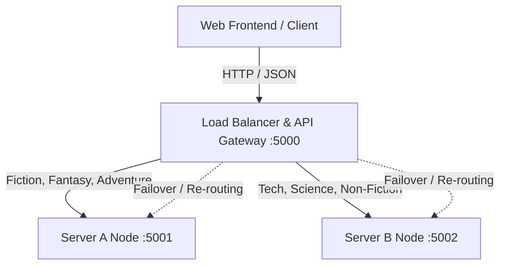

# Distributed Library Management System (Distributed LMS)

A distributed and fault-tolerant Library Management System built with Python Flask and vanilla web technologies. The architecture utilizes an API Gateway / Load Balancer that dynamically routes requests across backend server nodes using genre partitioning, dynamic performance scoring, and automatic failover.

---

## 🏗️ System Architecture



- **API Gateway / Load Balancer (`:5000`)**:
  - Central entry point for user authentication, catalog queries, book issue/return, and analytics.
  - **Genre-based Partitioning**: Primary routing directs specific book genres to dedicated nodes.
  - **Dynamic Routing Score**: Evaluates server load (active requests, latency, total throughput, CPU usage) to route requests intelligently.
  - **Fault Tolerance & Failover**: Monitors health of backend nodes and seamlessly redirects traffic if a node becomes unavailable.
  - **Audit & Metrics Logging**: Logs incoming and outgoing gateway traffic with response times and routing reasons.
- **Backend Node A (`:5001`)**: Hosts fiction, fantasy, and adventure catalogs.
- **Backend Node B (`:5002`)**: Hosts technology, science, history, and academic catalogs.
- **Modern Web Frontend**: Responsive UI for user authentication, catalog management, real-time server health monitoring, and system logs.

---

## 📁 Project Structure

```text
LMS/
├── frontend/             # Frontend UI (Dashboard, Login, Signup, Server status, Logs)
│   ├── dashboard.html
│   ├── login.html
│   ├── signup.html
│   ├── servers.html
│   ├── logs.html
│   └── style.css
├── load_balancer/        # API Gateway & Dynamic Load Balancer (Port 5000)
│   ├── app.py
│   ├── gateway_logs.json
│   ├── issue_records.json
│   └── users.json
├── server_a/             # Server Node A (Port 5001)
│   ├── app.py
│   └── server_a_books.json
├── server_b/             # Server Node B (Port 5002)
│   ├── app.py
│   └── server_b_books.json
├── models.py             # Data models, hashing, fine calculations, and routing score logic
├── requirements.txt      # Python dependencies
├── test_integration.py   # Automated integration and failover tests
└── README.md
```

---

## 🚀 Getting Started

### Prerequisites

- Python 3.9+
- pip

### 1. Install Dependencies

```bash
pip install -r requirements.txt
```

### 2. Start the Servers

Start each node in separate terminal windows:

**Terminal 1 — Server A (Port 5001):**
```bash
python server_a/app.py
```

**Terminal 2 — Server B (Port 5002):**
```bash
python server_b/app.py
```

**Terminal 3 — Load Balancer (Port 5000):**
```bash
python load_balancer/app.py
```

### 3. Access the Application

Open your browser and navigate to:
```text
http://localhost:5000/
```

Or open the frontend directly from `frontend/login.html`.

---

## 🧪 Running Integration Tests

To run the end-to-end integration and failover test suite:

```bash
python test_integration.py
```

---

## 📄 License

This project is open-source and available under the [MIT License](LICENSE).
